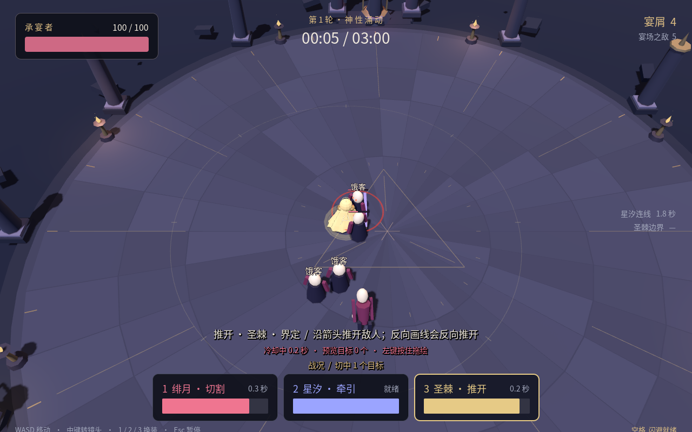
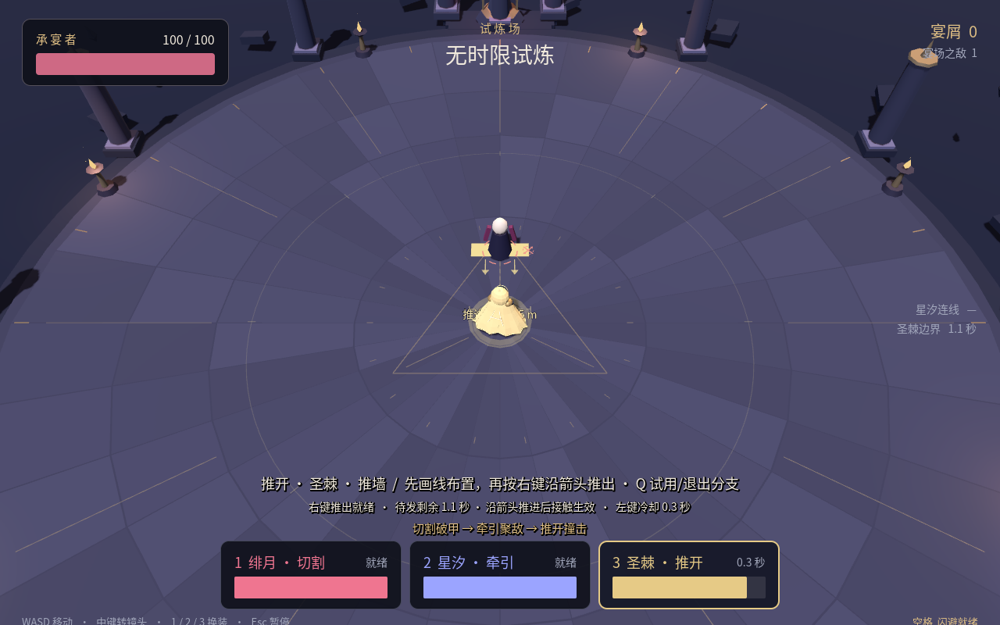

# 魔女的盛宴 2.0 · 战斗改版 v0.2

本轮针对范围难辨、反馈不清楚、战斗单调与成长缺少操作变化进行修改。三个新攻击分支可以直接在试炼场试用；完整后续成长树仍是待验收设计。

## 下载与设计

| 文件 | 用途 |
| --- | --- |
| [Windows 试玩包](https://raw.githubusercontent.com/JiJiang0420/JiJiang/refs/heads/codex/witches-feast-delivery/WitchesFeast2-v0.2-windows.zip) | 约 37 MB；解压后进入 windows 文件夹，双击 WitchesFeast2.exe，无需安装 Godot |
| [Linux 试玩包](https://raw.githubusercontent.com/JiJiang0420/JiJiang/refs/heads/codex/witches-feast-delivery/WitchesFeast2-v0.2-linux.zip) | 约 28 MB；解压后运行 WitchesFeast2.x86_64 |
| [Web 试玩包](https://raw.githubusercontent.com/JiJiang0420/JiJiang/refs/heads/codex/witches-feast-delivery/WitchesFeast2-v0.2-web.zip) | 约 10 MB；解压后以 HTTP 服务提供 web 目录，不能直接双击 HTML |
| [完整源码](https://raw.githubusercontent.com/JiJiang0420/JiJiang/refs/heads/codex/witches-feast-delivery/WitchesFeast2-v0.2-source.zip) | Godot 4.6.3 导入 game/project.godot；包含 Blender 源模型、策划文档与工具 |

[攻击分支与成长设计](source/docs/combat-growth-v0.2.md) · [完整 GDD](source/GDD.md) · [当前实现与验证范围](source/docs/vertical-slice-status.md) · [浏览源码](source) · [SHA-256 校验表](SHA256SUMS.txt)

如果浏览器打开文件页面，可使用 Download raw file 下载。v0.1 仍保留在本分支历史中，原来的固定版本链接继续有效。

## 这次改变了什么

- 范围圈、实际攻击宽度、预计命中目标圈与无效原因；推墙的方向和行进终点在待发期间持续可见。
- 伤害飘字、受击白闪、局部停顿、破甲碎片；布置、推进与命中使用不同音效。左键冷却和右键二段就绪分别显示。
- 开局六名普通敌人分两组接近，前两轮补充出现不同威胁，减少长时间等待敌人靠近。
- 敌人改名为 **饿客、疯仆、背锅人、老厨子**，并调整轮廓与动作反馈。
- 新增 **短切、收线、推墙** 三个分支和各一张配套成长卡。第一间商店选择分支，后两店可进一步强化或选其他斗篷的分支。

## 先用试炼场比较操作

在试炼场按 **Q** 试用或退出当前斗篷的分支，用 **1/2/3** 切换斗篷后分别按 Q。Q 不刷新冷却、不修改永久存档。

| 分支 | 操作与取舍 |
| --- | --- |
| 短切 | 左键短划、松开切割；间隔缩短至 0.65 秒，长度上限降至 4 米，单刀伤害与破甲降低 |
| 收线 | 先拖线连接敌人，至少等待 0.25 秒，再按右键造成第二段伤害并结束连接；过早按下不会排队执行 |
| 推墙 | 先画线布置，待发时不会自动打人；右键沿箭头推进，命中第一批后消失，最多待发 3 秒 |

**绘制期间右键始终只取消手势。** 松手后才执行二段操作。熟悉后进入「快速试玩 / 3 分钟」，检查敌人交互和三次商店选择。

WASD 移动；左键拖绘、松开施法；空格闪避；中键拖动旋转镜头；Home 复位；Esc 暂停；H 操作指南。正式战斗通过商店获得新分支。

## 已执行检查

- 51 项基础机制、85 项分支机制检查通过；52 项 Xorg 窗口输入检查通过。[日志](validation)
- Linux 最终独立包完成实际渲染与原生关闭，退出 0；报告记录二进制 SHA-256。
- 最终 Web 包完成本地 Chromium 基地、试炼、斗篷切换、暂停与恢复检查，无 Godot/JS/资源错误；报告记录资源包 SHA-256。
- Windows 已交叉导出，尚未在 Windows 实机运行。图形检查使用软件渲染，不证明目标显卡性能，也未验收可听音频质量。

本轮检查验证功能与输入流程；操作是否更有趣、节奏是否合适仍需玩家试玩。角色与场景采用简化素材、程序动作，完整成长树、正式骨骼动作和布料模拟尚未完成。

三个平台包保留 Godot 引擎与 Noto 字体许可。完整源码包含可重复运行的检查、建模、音频/字体生成与导出脚本。
