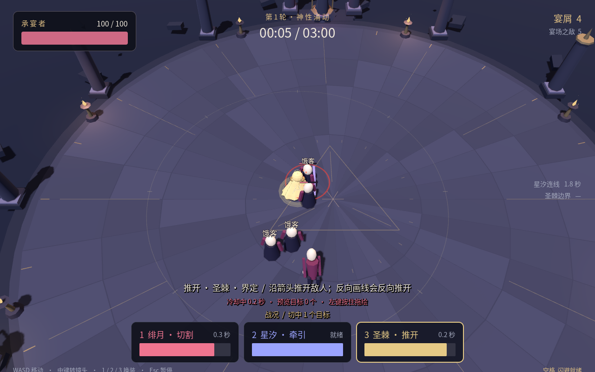

# 魔女的盛宴 2.0 · 三神遗宴

这是可交互的 Godot 3D 垂直切片，用于验证「手绘施法 → 切换斗篷 → 利用战场变化」以及一局战斗到永久成长的闭环。它实现了 GDD 的一部分核心内容，尚不是完整游戏或发行版本。

设计依据：[GDD](GDD.md) · [设计验收单](GDD-acceptance.md)  
当前实现与验证范围：[垂直切片状态](docs/vertical-slice-status.md)



## v0.2 这次怎么试

范围圈、判定宽度、命中圈和实际伤害飘字已加入；镜头拉近，敌人有白闪、局部受击停顿和破甲碎片。开局六名饿客分组进场，前几次补充即出现疯仆和背锅人。

先进入试炼场，按 **Q** 切换当前斗篷的新分支，再用 1/2/3 体验另外两件：

- **短切**：画更短的线，0.65 秒可再斩；覆盖范围和每刀破甲变小。
- **收线**：先连住敌人，等至少0.25秒再按右键；第二次伤害后连线结束。
- **推墙**：先画线布置，再按右键让墙沿箭头前进；待发时不会自动打人。

右键在绘制期间仍只取消手势。Q 不刷新冷却，也不改永久存档。正式战斗第一店必定给出三个分支，后两店可选配套或另一斗篷的分支。

完整分支和成长设计见[攻击成长 V0.2](docs/combat-growth-v0.2.md)。三个新样件已实现，文中的后续A/B分叉仍是设计。

## 开始试玩

[下载 v0.2 试玩包与完整源码](https://github.com/JiJiang0420/JiJiang/tree/codex/witches-feast-delivery)。交付页可直接查看本轮设计和验证记录。

首次建议选择基地中的 **进入试炼场**。试炼场没有时间限制、不会死亡、不产出货币；清理敌人后会补充一组，用于练习三种神权。熟悉后选择 **快速试玩 / 3 分钟**，可较快体验三次商店与首领。

| 模式 | 流程 |
| --- | --- |
| 进入盛宴 / 8 分钟 | 2、4、6 分钟进入商店，最后两分钟挑战首领 |
| 快速试玩 / 3 分钟 | 45、90、135 秒进入商店，最后 45 秒挑战首领；经济与解锁规则相同 |
| 进入试炼场 | 练习移动、绘制、切换与敌人交互；按 Esc 选择返回基地 |

商店和暂停时间不计入战斗时长。击败首领判胜；生命归零或战斗时间耗尽判负。同一模拟步中首领和玩家同时死亡时优先判胜。

### 用 Godot 打开源码

使用 **Godot 4.6.3 标准版**，无需 .NET。渲染模式是 Compatibility。Blender 仅在编辑或重新生成模型时需要；试玩使用已经导出的 GLB。

在 Godot 项目管理器中导入 [game/project.godot](game/project.godot)，等首次资源导入完成后打开项目，按 **F5** 运行。

也可从仓库根目录启动：

```bash
godot --editor --path projects/witches-feast-2/game
```

直接运行游戏：

```bash
godot --path projects/witches-feast-2/game
```

首次命令行启动前，建议先让编辑器完成一次资源导入。项目带有中文字体、模型和音频，不需要额外下载素材。

### 运行桌面导出包

云端导出目标目录是 `/workspace/witches-feast-builds-v0.2/`，它是执行工作区位置，**不是公网下载地址**。各平台包的实际完成与验证情况见状态文档。

- **Windows x64**：取得 Windows 包后运行 `WitchesFeast2.exe`，无需另装 Godot。当前导出将游戏资源嵌入可执行文件。
- **Linux x86_64**：取得 Linux 包后，在包目录赋予可执行权限并运行：

```bash
chmod +x WitchesFeast2.x86_64
./WitchesFeast2.x86_64
```

Web 是额外导出目标。Web 包需要由 HTTP 服务提供，不能靠双击 HTML 验证；本次已在 Chromium 中完成本地启动、试炼场渲染、切换和暂停检查；其他浏览器与完整单局兼容性仍需验证。

## 默认操作

| 操作 | 输入 |
| --- | --- |
| 移动 | WASD，方向相对当前镜头 |
| 绘制并施法 | 按住左键拖动，松开释放 |
| 取消绘制／收线／推出边界 | 右键；绘制时只取消，松手后执行当前分支的二段操作 |
| 试用／退出当前斗篷分支 | Q，仅限试炼场 |
| 切换绯月 / 星汐 / 圣棘 | 1 / 2 / 3 |
| 闪避 | 空格；无移动输入时沿角色朝向 |
| 旋转镜头 | 按住鼠标中键拖动；绘制期间暂停旋转 |
| 恢复镜头朝向 | Home；绘制期间无效 |
| 暂停或恢复 | Esc |
| 打开或关闭操作指南 | H；战斗中打开指南会暂停 |

默认有效施法范围为角色周围约八米。请使用短手势；持续绘制超过 2.4 秒会取消。无效释放不进入冷却，也不替换已有结构。切换或闪避会取消尚未释放的绘制，需要重新按下左键施法。

当前没有键位重绑、音量或画面设置菜单。窗口失焦会自动暂停普通试玩；恢复后重新按下绘制键。

## 三件斗篷怎么用

| 斗篷 | 绘制方法 | 主要效果 |
| --- | --- | --- |
| 绯月 · 断裂 | 在敌人身上划一条短线或短曲线 | 造成伤害、破坏装甲、留下裂痕；同一条轨迹重复经过同一敌人不重复命中 |
| 星汐 · 流转 | 从敌人拖向另一敌人，或在敌人与地面锚点之间拖线 | 建立时造成一次收紧伤害，之后持续牵引；可以独立攻击单个敌人 |
| 圣棘 · 界定 | 绘制有方向的直线 | 落在敌人身上可直接裁定；也可等待敌人或可偏转攻击接触。箭头决定推开或改向方向 |

同一时间最多保留一条星汐连接和一条圣棘边界。切换斗篷后，它们按剩余寿命继续存在；新的有效同类法术会替换旧结构。

建议在试炼场依次尝试：

1. 分别用三件斗篷击败普通饿客。
2. 用绯月切开背锅人装甲，再用星汐观察牵引变化。
3. 对已连接或聚集的敌人立界，观察裁定与位置变化。
4. 看清疯仆的冲锋预警，用圣棘改变其方向。
5. 连线存在时换斗篷，确认旧效果继续工作。

组合依赖角度、站位与时机；任意切换和画线并不保证产生撞击。三件基础神权从新存档起全部可用。

## 商店、永久成长与保存

每完成一个普通阶段，获得 **60 宴屑与 10 残纱**。击杀会额外提供有阶段上限的宴屑；胜利另得 30 残纱。

- 宴屑用于本局商店。每次提供三个候选，每项 60，每店最多购买两项；可以不购买直接继续。
- 残纱用于基地永久解锁。三件变律各需 30，共织需 60。
- 解锁后在基地点击装备或卸下，换装不重复收费。
- 本局结束清空宴屑与临时强化；已经成功保存的残纱、解锁和装备配置保留。
- 首版不支持中途退出后续接本局。暂停菜单返回基地会结束当前局；试炼场不写入奖励。

当前可解锁：绯月「回斩」、星汐「单向导流」、圣棘「延界」及共织「断后引流」。装备单向导流后，单敌施法需从地面锚点画向敌人；装备延界后，同一目标不会因重复穿越而反复受伤。

存档使用 Godot 的 `user://progress.json`，并保留最近有效备份。通常位置为：

| 平台 | 默认目录 |
| --- | --- |
| Windows | `%APPDATA%\WitchesFeast2\` |
| Linux | `$XDG_DATA_HOME/WitchesFeast2/`；未设置时为 `~/.local/share/WitchesFeast2/` |

云端运行若设置了独立 XDG 目录，则存档位于该目录下。不要用真实试玩存档运行测试；测试说明提供了隔离目录流程。

## 源文件与工具

| 位置 | 内容 |
| --- | --- |
| [game/project.godot](game/project.godot) | Godot 工程入口 |
| [game/scripts](game/scripts) | 战斗、角色、敌人、场景、UI 与存档脚本 |
| [game/assets/models/witch.blend](game/assets/models/witch.blend) | Blender 4.3.2 制作的可编辑魔女模型源文件 |
| [game/assets/models/player.glb](game/assets/models/player.glb) | 运行时显式导入的模型 |
| [tools/build_models.py](tools/build_models.py) | 原创模型生成脚本 |
| [game/assets/audio](game/assets/audio) | 原创程序合成的环境与反馈音频 |
| [game/assets/fonts/LICENSE.txt](game/assets/fonts/LICENSE.txt) | Noto 中文字体来源与许可说明 |
| [game/tests/README.md](game/tests/README.md) | 隔离存档的真实机制测试运行方法 |

模型、宴场几何、符号与声音为本项目程序生成内容。中文字体使用 Noto CJK 子集，随项目保留相应许可；它不是本项目原创字体。当前没有 Krita `.kra` 绘画源文件，不把程序几何或已有字体描述为完成了手绘资产制作。

从本项目目录重新生成模型：

```bash
blender --background --python tools/build_models.py -- game/assets/models
```

## 重新生成与打包

程序音效与中文字体子集有可复现来源（字体生成需要 Python 的 `fontTools` 与 Noto CJK SC 原始字体）：

```bash
python3 tools/generate_assets.py --audio
python3 tools/generate_assets.py --font
```

安装 Godot 4.6.3 对应导出模板后，使用 Python 3.11 或更新版本：

```bash
python3 tools/build.py --output /path/to/builds
```

此脚本完成资源导入、隔离存档的机制检查、Windows/Linux/Web 导出，打包三个平台包及源码包，附带字体/引擎许可和 SHA-256 校验表。图形输入检查单独运行，见测试说明。工具不会自动下载导出模板。

## 当前边界

本切片已经串起三权能、敌人、阶段商店、首领、结算与最小永久成长。角色使用简化模型、材质换色和程序动画，尚无正式骨骼动作制作或布料模拟；完整 GDD 的全部变律、共织、设置、剧情和美术内容并未完成。

当前验证以机制测试与云端 Linux 图形环境为主；本次反馈是否已解决仍需实际试玩。Windows 实机、更多浏览器和 GDD 目标硬件表现需要分别验证，导出成功不能代替这些验证。详细记录见[垂直切片状态](docs/vertical-slice-status.md)。
